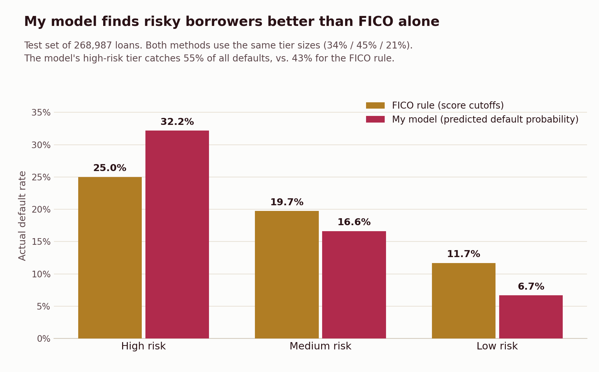

### **Credit Risk Analytics and Machine Learning Dashboard**

**A project analyzing loan default risk using machine learning and data visualization**.

\-**What This Project Does**

I built a system to predict which borrowers are most likely to default (not pay back) on their loans. I used data from 1.34 million loans, trained a machine learning model, and created a dashboard to visualize the results.

**My Results**

Model Accuracy:69.2% Area Under the Curve (measures how well the model predicts defaults)

&#x20;Data Size: 1.34 million loans analyzed

&#x20;Risk Groups:

&#x20; - HIGH risk: 34% of borrowers

&#x20; - MEDIUM risk: 45% of borrowers  

&#x20; - LOW risk: 21% of borrowers

&#x20;Average Default Rate: About 20% of borrowers are predicted to default out of 1.34 million.

&#x20;**Tools and Technologies**

\-Python- For data analysis and machine learning (using pandas and scikit-learn libraries)

\-SQL- To store and organize the data in a database

\-Tableau- To create interactive charts and visualizations

\-Jupyter Notebook - To write and run all my code

&#x20;

&#x20;**How I Built This**

&#x20;**Step 1: Cleaning the Data**

\- Started with 2.26 million loan records from LendingClub

\- Picked 6 important variables that predict defaults:

&#x20; - Loan amount

&#x20; - Interest rate

&#x20; - FICO credit score

&#x20; - Debt-to-income ratio

&#x20; - Annual income

&#x20; - Number of past delinquencies

\- Created a simple yes/no variable: did they default or pay back the loan?

&#x20;**Step 2: Creating Risk Groups**

\- Divided borrowers into HIGH, MEDIUM, and LOW risk based on their FICO scores

\- Checked if it made sense: HIGH risk borrowers defaulted 2.2 times more often than LOW risk borrowers

**Step 3: Training the Machine Learning Model**

\- Used Logistic Regression (using what I learned in class)

\- Split the data into two 80% for training, 20% for testing

\- The model learns patterns from the training data and predicts default probability for each borrower on the test data.

\- Achieved 69% accuracy on the test set

**Step 4: Building the Dashboard**

I created a Tableau dashboard with:

\- Summary cards showing total loans, loan amounts, and average default risk

\- A pie chart breaking down the percentage of HIGH/MEDIUM/LOW risk borrowers

\- A scatter plot showing the relationship between FICO scores and debt-to-income ratios, color-coded by risk level

## Model risk tiers vs FICO tiers

My first risk tiers in SQL used simple FICO score cutoffs. To see if my model does better, I grouped borrowers by the model's predicted default probability instead. I kept the same tier sizes as the FICO tiers (34%, 45%, and 21% of loans) so the comparison is fair. All numbers come from the 20% test set of 268,987 loans.

* In the high risk tier, 32.2% of loans defaulted with my model, compared to 25.0% with the FICO rule
* My model's high risk tier caught 55% of all defaults, compared to 43% for the FICO rule
* In the low risk tier, only 6.7% of loans defaulted with my model, compared to 11.7% with the FICO rule
* Interest rate had the biggest effect on default risk, followed by annual income (higher income means lower risk) and loan amount

This means a lender could use the model's tiers to catch more risky loans and approve safer loans with more confidence. The code is in `model_tiers_cells.ipynb`. Run those cells at the end of `Credit_Analysis_Project.ipynb`, since they use the model and test set from that notebook.

**Interactive Tableau Dashboard** - https://public.tableau.com/app/profile/chheten.tamang/viz/Credit\_Risk\_Dashboard\_17780336103260/CreditRiskAnalyticsDashboard?publish=yes

**Why This Project?**

Banks and lenders can use this type of model to:

\- Decide which loan applications to approve

\- Set fair interest rates based on how risky each borrower is

\- Track how risky their overall loan portfolio is

\- Reduce losses from borrowers who may default

**Where I Got the Data**

I used publicly available data from LendingClub, downloaded from Kaggle.

